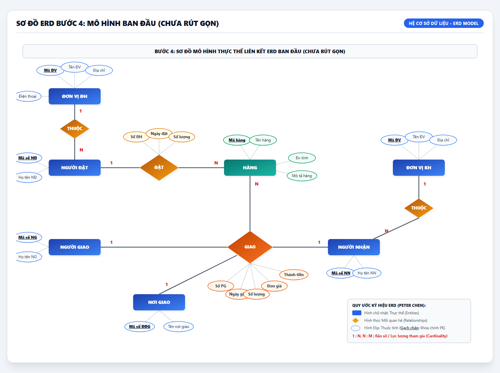
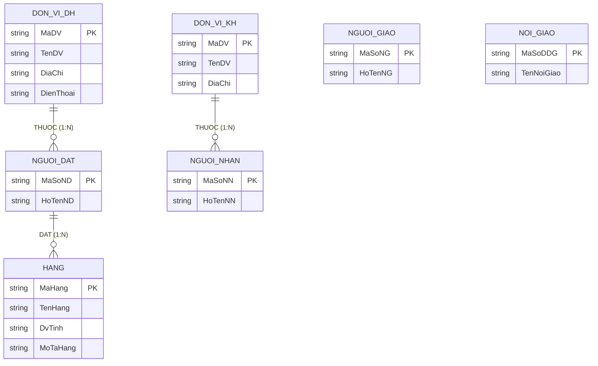
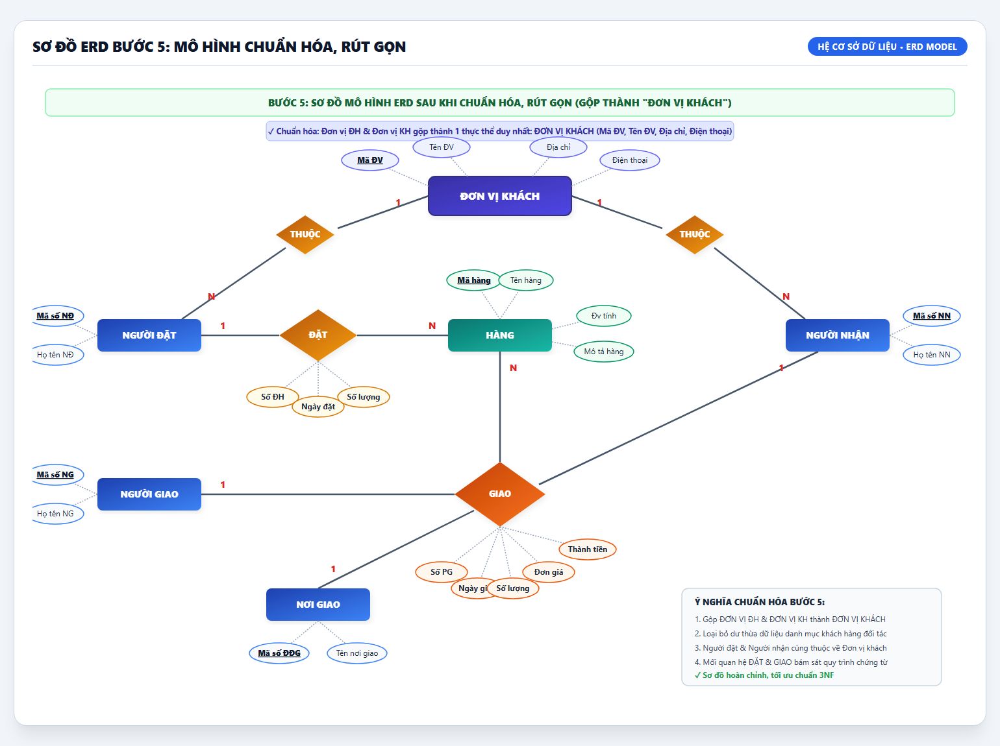
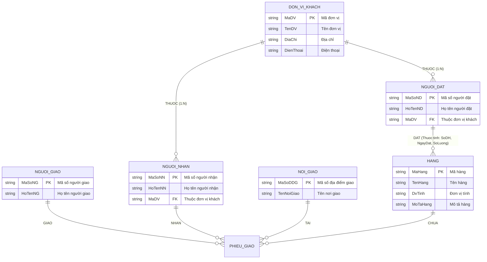
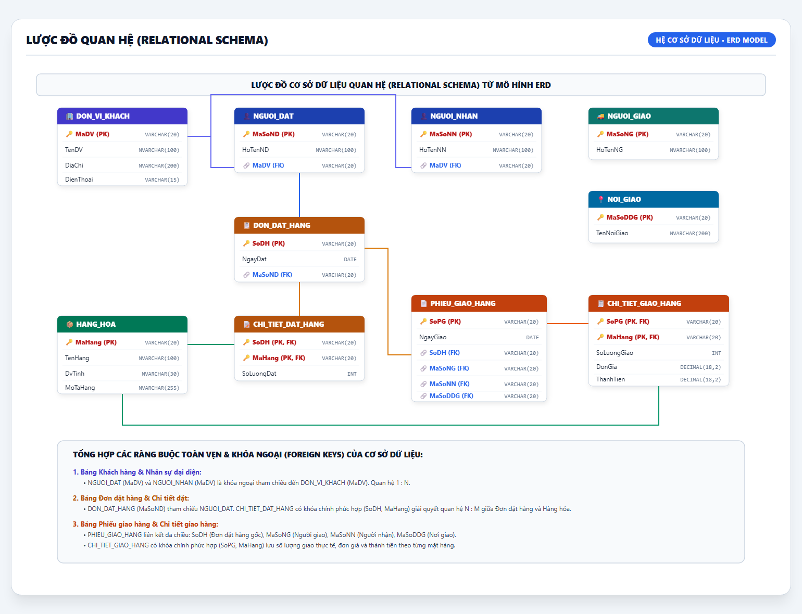

# BÀI TẬP: XÂY DỰNG MÔ HÌNH ERD CHO CƠ SỞ DỮ LIỆU QUẢN LÝ ĐƠN ĐẶT HÀNG

- **Mục tiêu:** Xây dựng mô hình Thực thể - Liên kết (ERD) hoàn chỉnh từ bài toán quản lý đơn đặt hàng và phiếu giao hàng.
- **Sinh viên thực hiện:** DTC245200413 (`dtc245200413-cmyk`)
- **Đường dẫn nộp bài (Repository):** [https://github.com/dtc245200413-cmyk/backend](https://github.com/dtc245200413-cmyk/backend)

---

## MỤC LỤC BÀI LÀM
1. [Bước 1: Liệt kê, chọn lọc thông tin](#bước-1-liệt-kê-chọn-lọc-thông-tin)
2. [Bước 2: Xác định thực thể và thuộc tính](#bước-2-xác-định-thực-thể-và-thuộc-tính)
3. [Bước 3: Xác định các mối quan hệ (Relationships)](#bước-3-xác-định-các-mối-quan-hệ-relationships)
4. [Bước 4: Biểu đồ mô hình thực thể ERD ban đầu (Chưa rút gọn)](#bước-4-biểu-đồ-mô-hình-thực-thể-erd-ban-đầu-chưa-rút-gọn)
5. [Bước 5: Chuẩn hóa, rút gọn mô hình thực thể ERD](#bước-5-chuẩn-hóa-rút-gọn-mô-hình-thực-thể-erd)
6. [Mở rộng: Lược đồ cơ sở dữ liệu quan hệ (Relational Schema) & Mã nguồn SQL](#mở-rộng-lược-đồ-cơ-sở-dữ-liệu-quan-hệ-relational-schema--mã-nguồn-sql)

---

## BƯỚC 1: LIỆT KÊ, CHỌN LỌC THÔNG TIN

Từ yêu cầu bài toán quản lý quy trình nghiệp vụ đặt hàng và giao hàng, hệ thống bao gồm hai chứng từ chính với các trường thông tin sau:

### 1. Đơn đặt hàng (Purchase Order)
| STT | Tên thông tin | Ký hiệu / Tên thuộc tính | Ý nghĩa nghiệp vụ |
|:---:|:---|:---|:---|
| 1 | Số đơn hàng | `Số ĐH` | Mã định danh đơn hàng (Khóa chính) |
| 2 | Tên đơn vị đặt hàng | `Tên ĐV` | Đơn vị/Công ty mua hàng |
| 3 | Địa chỉ | `Địa chỉ` | Địa chỉ của đơn vị đặt |
| 4 | Điện thoại | `Điện thoại` | Số điện thoại liên hệ |
| 5 | Ngày đặt | `Ngày đặt` | Ngày lập đơn hàng |
| 6 | Tên hàng | `Tên hàng` | Tên sản phẩm được đặt |
| 7 | Mô tả | `Mô tả hàng` | Thông số, quy cách mặt hàng |
| 8 | Đơn vị tính | `Đv tính` | Cái, thùng, kiện, bộ... |
| 9 | Số lượng | `Số lượng` | Số lượng hàng hóa cần đặt |
| 10 | Người đặt hàng | `Họ tên NĐ` | Người đại diện tạo đơn hàng |

### 2. Phiếu giao hàng (Delivery Note)
| STT | Tên thông tin | Ký hiệu / Tên thuộc tính | Ý nghĩa nghiệp vụ |
|:---:|:---|:---|:---|
| 1 | Số phiếu giao hàng | `Số PG` | Mã định danh phiếu giao (Khóa chính) |
| 2 | Tên đơn vị đặt hàng | `Tên ĐV` | Tên đơn vị đối tác mua hàng |
| 3 | Địa chỉ | `Địa chỉ` | Địa chỉ đối tác |
| 4 | Nơi giao hàng | `Tên nơi GH` | Địa điểm kho/chi nhánh nhận hàng |
| 5 | Ngày giao | `Ngày giao` | Thời điểm thực hiện giao hàng |
| 6 | Tên hàng | `Tên hàng` | Tên mặt hàng thực giao |
| 7 | Đơn vị tính | `Đv tính` | Đơn vị tính của hàng |
| 8 | Số lượng | `Số lượng` | Số lượng hàng thực giao |
| 9 | Đơn giá | `Đơn giá` | Giá tiền cho 1 đơn vị hàng |
| 10 | Thành tiền | `Thành tiền` | Tổng giá trị = Số lượng × Đơn giá |
| 11 | Tên người nhận | `Họ tên NN` | Đại diện nhận hàng bên mua |
| 12 | Tên người giao | `Họ tên NG` | Nhân viên giao hàng của đơn vị bán |

---

## BƯỚC 2: XÁC ĐỊNH THỰC THỂ VÀ THUỘC TÍNH

Phân tách các trường dữ liệu trên thành 7 thực thể nghiệp vụ ban đầu (Khóa chính được gạch chân):

1. **Thực thể `ĐƠN VỊ ĐH` (Đơn vị đặt hàng):**
   - <u>`Mã ĐV`</u> (Khóa chính)
   - `Tên ĐV`
   - `Địa chỉ`
   - `Điện thoại`
2. **Thực thể `ĐƠN VỊ KH` (Đơn vị khách hàng / nhận hàng):**
   - <u>`Mã ĐV`</u> (Khóa chính)
   - `Tên ĐV`
   - `Địa chỉ`
3. **Thực thể `HÀNG` (Hàng hóa / Sản phẩm):**
   - <u>`Mã hàng`</u> (Khóa chính)
   - `Tên hàng`
   - `Đv tính`
   - `Mô tả hàng`
4. **Thực thể `NGƯỜI ĐẶT`:**
   - <u>`Mã số NĐ`</u> (Khóa chính)
   - `Họ tên NĐ`
5. **Thực thể `NƠI GIAO` (Địa điểm giao hàng):**
   - <u>`Mã số ĐĐG`</u> (Khóa chính)
   - `Tên nơi giao`
6. **Thực thể `NGƯỜI NHẬN`:**
   - <u>`Mã số NN`</u> (Khóa chính)
   - `Họ tên NN`
7. **Thực thể `NGƯỜI GIAO`:**
   - <u>`Mã số NG`</u> (Khóa chính)
   - `Họ tên NG`

---

## BƯỚC 3: XÁC ĐỊNH CÁC MỐI QUAN HỆ (RELATIONSHIPS)

Hai động từ nghiệp vụ cốt lõi tìm được trong bài toán là: **ĐẶT** và **GIAO**.

### 1. Phân tích mối quan hệ nghiệp vụ bằng câu hỏi:
- **Quan hệ ĐẶT:**
  - *Câu hỏi:* Ai đặt? Đặt cái gì?
  - *Trả lời:* `NGƯỜI ĐẶT` thực hiện **ĐẶT** `HÀNG`.
  - *Thuộc tính phát sinh trên mối quan hệ ĐẶT:* `{Số ĐH, Ngày đặt, Số lượng}`.
- **Quan hệ GIAO:**
  - *Câu hỏi:* Ai giao? Cho ai? Tại đâu? Giao mặt hàng nào?
  - *Trả lời:* `NGƯỜI GIAO` phối hợp bàn **GIAO** `HÀNG` cho `NGƯỜI NHẬN` tại `NƠI GIAO`.
  - *Thuộc tính phát sinh trên mối quan hệ GIAO:* `{Số PG, Ngày giao, Số lượng, Đơn giá, Thành tiền}`.

### 2. Xác định các mối quan hệ sở hữu / phụ thuộc (THUỘC):
- **Người đặt hàng THUỘC Đơn vị đặt hàng:** 
  - `NGƯỜI ĐẶT` **(N)** — [THUỘC] — **(1)** `ĐƠN VỊ ĐH`
  - *(Một đơn vị đặt hàng có thể có nhiều người đặt đại diện; một người đặt thuộc về một đơn vị cụ thể).*
- **Người nhận hàng THUỘC Đơn vị khách hàng:**
  - `NGƯỜI NHẬN` **(N)** — [THUỘC] — **(1)** `ĐƠN VỊ KH`
  - *(Một đơn vị khách hàng có thể có nhiều người nhận; một người nhận thuộc về một đơn vị khách).*

---

## BƯỚC 4: BIỂU ĐỒ MÔ HÌNH THỰC THỂ ERD BAN ĐẦU (CHƯA RÚT GỌN)

Tại bước này, hai thực thể `ĐƠN VỊ ĐH` và `ĐƠN VỊ KH` được mô hình hóa riêng biệt:

---

## BƯỚC 5: CHUẨN HÓA, RÚT GỌN MÔ HÌNH THỰC THỂ ERD

### 1. Lý do và giải pháp chuẩn hóa, rút gọn:
- **Phân tích:** Trong thực tế kinh doanh, đối tượng phát sinh đơn đặt hàng (`ĐƠN VỊ ĐH`) và đối tượng tiếp nhận phiếu giao hàng (`ĐƠN VỊ KH`) đều là các tổ chức/doanh nghiệp bên ngoài giao dịch với cửa hàng.
- **Giải pháp:** Ta tiến hành **gộp** hai thực thể `ĐƠN VỊ ĐH` và `ĐƠN VỊ KH` thành một thực thể duy nhất: **`ĐƠN VỊ KHÁCH`**.
- **Thuộc tính thực thể gộp:**
  - <u>`Mã ĐV`</u> (Khóa chính)
  - `Tên ĐV`
  - `Địa chỉ`
  - `Điện thoại`
- **Quan hệ cập nhật:** Cả `NGƯỜI ĐẶT` và `NGƯỜI NHẬN` đều trực thuộc thực thể **`ĐƠN VỊ KHÁCH`**.

### 2. Sơ đồ mô hình ERD chuẩn hóa hoàn chỉnh:

---

## MỞ RỘNG: LƯỢC ĐỒ CƠ SỞ DỮ LIỆU QUAN HỆ (RELATIONAL SCHEMA) & MÃ NGUỒN SQL

Từ mô hình ERD ở Bước 5, chuyển đổi sang mô hình CSDL quan hệ đạt chuẩn dạng chuẩn 3 (3NF) để loại bỏ hoàn toàn dư thừa dữ liệu:

### Danh sách các bảng dữ liệu:
1. **`DON_VI_KHACH`** (<u>MaDV</u>, TenDV, DiaChi, DienThoai)
2. **`NGUOI_DAT`** (<u>MaSoND</u>, HoTenND, *MaDV*)
3. **`NGUOI_NHAN`** (<u>MaSoNN</u>, HoTenNN, *MaDV*)
4. **`NGUOI_GIAO`** (<u>MaSoNG</u>, HoTenNG)
5. **`NOI_GIAO`** (<u>MaSoDDG</u>, TenNoiGiao)
6. **`HANG_HOA`** (<u>MaHang</u>, TenHang, DvTinh, MoTaHang)
7. **`DON_DAT_HANG`** (<u>SoDH</u>, NgayDat, *MaSoND*)
8. **`CHI_TIET_DAT_HANG`** (<u>*SoDH*</u>, <u>*MaHang*</u>, SoLuongDat)
9. **`PHIEU_GIAO_HANG`** (<u>SoPG</u>, NgayGiao, *SoDH*, *MaSoNG*, *MaSoNN*, *MaSoDDG*)
10. **`CHI_TIET_GIAO_HANG`** (<u>*SoPG*</u>, <u>*MaHang*</u>, SoLuongGiao, DonGia, ThanhTien)

File mã nguồn SQL khởi tạo CSDL và chèn dữ liệu mẫu có sẵn tại: [`database_orders.sql`](database_orders.sql).

---

## TỔNG KẾT & LINK NỘP BÀI
- **Đường dẫn nộp bài (GitHub URL):** [https://github.com/dtc245200413-cmyk/backend](https://github.com/dtc245200413-cmyk/backend)
- **Tất cả các hình ảnh sơ đồ ERD:** Nằm trong thư mục [`assets/`](assets/) gồm cả file `.png`, `.svg` và `.html`.
